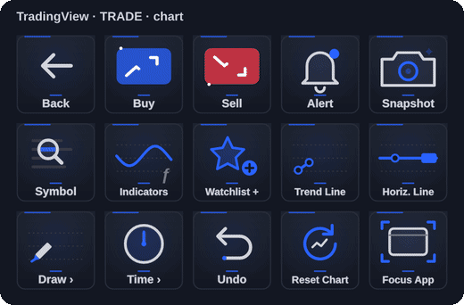
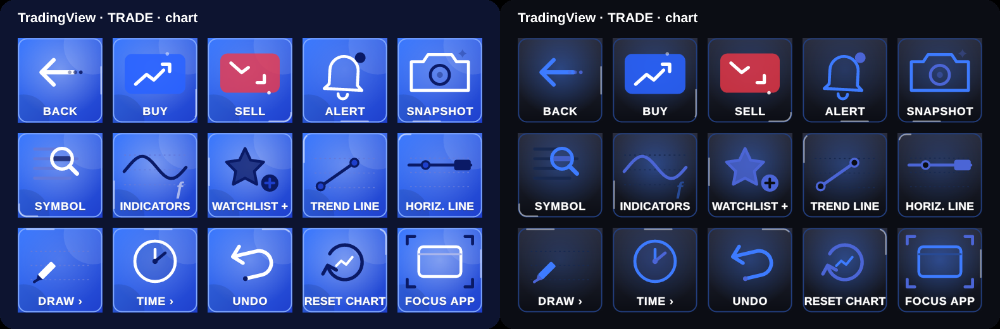

# TradingView Controls

Unofficial Windows companion for Elgato Stream Deck and the TradingView desktop app. Version 1.0.0.0.

Three pages, 15 keys each, built around TradingView's own keyboard shortcuts:

| Page | Keys |
|---|---|
| **Trade · chart** | Back, Buy, Sell, Alert, Snapshot, Symbol, Indicators, Watchlist +, Trend Line, Horiz. Line, Draw ›, Time ›, Undo, Reset Chart, Focus App |
| **Draw · analyze** | ‹ Trade, Trend Line, Horiz. Line, Vert. Line, Cross Line, Fib Retrace, Note, Log Scale, % Scale, Invert, Go To Date, Maximize, Save Layout, Load Layout, Time › |
| **Time · intervals** | ‹ Trade, 1m, 2m, 5m, 15m, 1h, 4h, Daily, Weekly, Go To Date, Bar Back, Bar Fwd, Undo, Redo, Focus App |



## Shortcuts used

| Key | Shortcut | Key | Shortcut |
|---|---|---|---|
| Alert | Alt+A | Snapshot | Alt+S |
| Symbol (quick search) | Ctrl+K | Indicators | / |
| Watchlist + | Alt+W | Trend Line | Alt+T |
| Horiz. / Vert. / Cross Line | Alt+H / Alt+V / Alt+C | Fib Retrace | Alt+F |
| Note | Alt+N | Log / % Scale | Alt+L / Alt+P |
| Invert | Alt+I | Go To Date | Alt+G |
| Maximize | Alt+Enter | Reset Chart | Alt+R |
| Save / Load Layout | Ctrl+S / . | Undo / Redo | Ctrl+Z / Ctrl+Y |
| Bar Back / Fwd | ← / → | Intervals | Esc, minutes (1, 2, 5, 15, 60, 240) or 1D / 1W, Enter |

Every key checks that TradingView is the window in front before each step. If you changed a shortcut in TradingView, type yours in the key's settings. Trend Line, Fib and Symbol use widely reported shortcuts; override them if your TradingView version differs.

## Buy and Sell

Buy and Sell show **SETUP** until you type TradingView's shortcut into the key settings: **Shift+B** for Buy, **Shift+S** for Sell. After that, one tap sends that one shortcut once; it is never queued, repeated while held, or followed by Enter. TradingView and your connected broker decide what happens: with instant (one-click) orders on, a market order is placed immediately; otherwise the order ticket opens. Quantity, account and confirmations come from TradingView.

Other keys in this trading app send a single shortcut and never Enter. The only exceptions are the built-in Maximize and interval keys, which need Enter and start with Escape so a focused order ticket is closed first. Overriding those keys with your own shortcut removes the exception. No live orders were placed during development or testing.

## Install in three steps

1. Download **TradingViewControls-Installer-1.0.0.0.zip** from [Releases](https://github.com/nikhilgs817/streamdeck_tradingview/releases/latest).
2. Right-click the ZIP, choose **Extract All**, and open the extracted folder.
3. Double-click **Install-TradingViewControls.cmd**. Stream Deck restarts automatically.

No Git, Node.js or build commands are required. The installer verifies files, backs up your setup, preserves existing layouts and settings, and rolls back failed updates. [Full installation guide](docs/INSTALL.md).

## Use

Requires Windows 10/11 64-bit, Stream Deck 7.1+ and the TradingView desktop app. Choose the **TradingView** profile in Stream Deck (or let Windows Daily Toolkit switch to it). **Back** returns to your main keys. Select any key to change its shortcut or look.

## Appearance



**TradingView Dark** is the default: TradingView navy keys, the TradingView blue accent, bull green and bear red candles, bold Segoe UI labels and an animated icon on every key (the trend line draws itself, Fib levels sweep, the price line slides, the camera flashes, the bell rings, the interval bar fills). Buy is TradingView blue and Sell red in every style. TradingView Light, Colourful, Vivid and Pro share the icons. Decorative candles and lines are animation only, never live market data.

## Build and verify

```sh
npm ci
npm run build
npm test
npm run test:ui
npm run validate
npm run pack
npm run build:installer
```

## Trading risk

Trading involves risk of loss. This plugin only sends the keyboard shortcuts you configure; TradingView and your broker decide what an order does. **Use at your own risk, test with Paper Trading first, and keep order keys where you won't press them by accident.** Not financial advice; no warranty or liability (see LICENSE).

Not affiliated with or endorsed by TradingView, Inc. TradingView is a trademark of TradingView, Inc. The icons are original artwork. MIT license.
