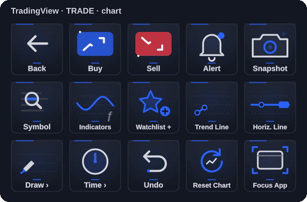
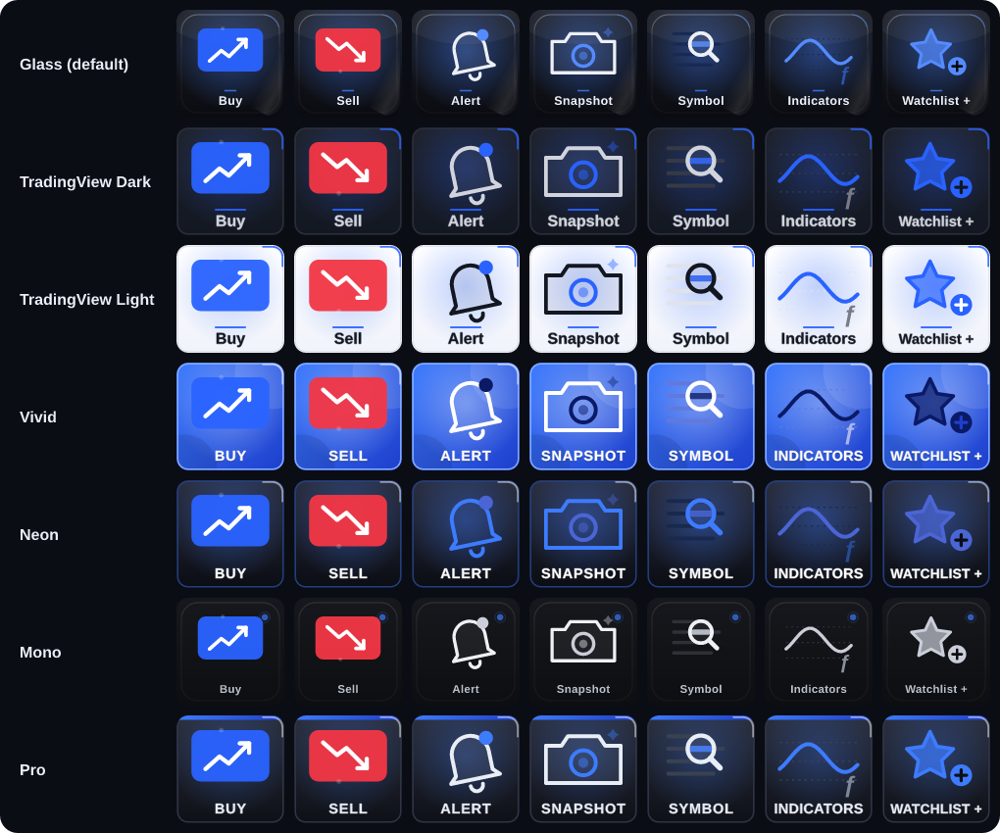

# TradingView Controls

Unofficial Windows companion for Elgato Stream Deck and the TradingView desktop app. Version 2.1.0.0.

Three pages, 15 keys each, built around TradingView's own keyboard shortcuts:

| Page | Keys |
|---|---|
| **Trade · chart** | Back, Buy, Sell, Alert, Snapshot, Symbol, Indicators, Watchlist +, Trend Line, Horiz. Line, Draw ›, Time ›, Undo, Reset Chart, Focus App |
| **Draw · analyze** | ‹ Trade, Trend Line, Horiz. Line, Vert. Line, Cross Line, Fib Retrace, Note, Log Scale, % Scale, Invert, Go To Date, Maximize, Save Layout, Load Layout, Time › |
| **Time · intervals** | ‹ Trade, 1m, 2m, 5m, 15m, 1h, 4h, Daily, Weekly, Go To Date, Bar Back, Bar Fwd, Undo, Redo, Focus App |



## Shortcuts used

| Key | Shortcut | Key | Shortcut |
|---|---|---|---|
| Alert | Alt+A | Snapshot | Alt+S |
| Symbol (quick search) | Ctrl+K | Indicators | / |
| Watchlist + | Alt+W | Trend Line | Alt+T |
| Horiz. / Vert. / Cross Line | Alt+H / Alt+V / Alt+C | Fib Retrace | Alt+F |
| Note | Alt+N | Log / % Scale | Alt+L / Alt+P |
| Invert | Alt+I | Go To Date | Alt+G |
| Maximize | Alt+Enter | Reset Chart | Alt+R |
| Save / Load Layout | Ctrl+S / . | Undo / Redo | Ctrl+Z / Ctrl+Y |
| Bar Back / Fwd | ← / → | Intervals | Esc, minutes (1, 2, 5, 15, 60, 240) or 1D / 1W, Enter |

Every key checks that TradingView is the window in front before each step. If you changed a shortcut in TradingView, type yours in the key's settings. Trend Line, Fib and Symbol use widely reported shortcuts; override them if your TradingView version differs.

## Buy and Sell

Buy and Sell show **SETUP** until you type TradingView's shortcut into the key settings: **Shift+B** for Buy, **Shift+S** for Sell. After that, one tap sends that one shortcut once; it is never queued, repeated while held, or followed by Enter. TradingView and your connected broker decide what happens: with instant (one-click) orders on, a market order is placed immediately; otherwise the order ticket opens. Quantity, account and confirmations come from TradingView.

Other keys in this trading app send a single shortcut and never Enter. The only exceptions are the built-in Maximize and interval keys, which need Enter and start with Escape so a focused order ticket is closed first. Overriding those keys with your own shortcut removes the exception. No live orders were placed during development or testing.

## Install in three steps

1. Download **TradingViewControls-Installer-2.1.0.0.zip** from [Releases](https://github.com/nikhilgs817/streamdeck_tradingview/releases/latest).
2. Right-click the ZIP, choose **Extract All**, and open the extracted folder.
3. Double-click **Install-TradingViewControls.cmd**. Stream Deck restarts automatically.

No Git, Node.js or build commands are required. The installer verifies files, backs up your setup, preserves existing layouts and settings, and rolls back failed updates. [Full installation guide](docs/INSTALL.md).

## New in 2.1: Design System 4

| What | Details |
|---|---|
| **Glass is the new default** | Frosted dark keys, a soft rim light and Title Case labels. TradingView Dark, TradingView Light, Vivid, Neon (formerly Colourful) and Pro are still here, plus the new **Mono** look. |
| **Custom colours** | Pick any two colours for a key instead of a theme. |
| **Motion styles** | Full, Glow only, Icon only or Still, at Slow, Calm, Normal or Fast. |
| **Glow and ripple** | Subtle, Normal or Bold glow, and a short ripple when you press a key (can be turned off per key). |
| **Labels** | Up to 18 letters, fitted to the key, in Auto, Title Case or UPPER CASE. |
| **Whole deck at once** | **Use this look on all keys** restyles every key of the plugin. |
| **Respects Windows** | Keys stop moving when Windows **Animation effects** is off (you can opt out). |

The design is shared with [Windows Toolkit](https://github.com/nikhilgs817/windows_toolkit) 3.1, so all your plugins can look the same.

## Use

Requires Windows 10/11 64-bit, Stream Deck 7.1+ and the TradingView desktop app. Choose the **TradingView** profile in Stream Deck (or let Windows Toolkit switch to it). **Back** returns to your main keys. Select any key to change its shortcut or look.

## Appearance



**Glass** is the default: frosted dark keys, a soft rim light, Title Case labels and an animated icon on every key (the trend line draws itself, Fib levels sweep, the price line slides, the camera flashes, the bell rings, the interval bar fills). Pick another look for one key, or press **Use this look on all keys** in any key's settings to restyle the whole deck.

| Style | Look |
|---|---|
| **Glass** (default) | Frosted dark glass, a quiet glow and Title Case labels |
| **TradingView Dark** | TradingView navy keys, the TradingView blue accent, bull green and bear red candles, bold Segoe UI labels |
| **TradingView Light** | Light chart-paper keys with the same icons |
| **Vivid** | White icons on a bright gradient |
| **Neon** | Coloured icons with a glowing edge on dark glass (formerly Colourful) |
| **Mono** | Monochrome icons with a single colour dot |
| **Pro** | Restrained slate keys with a thin accent strip |

Select a key in Stream Deck and open **Look**:

| Setting | Choices |
|---|---|
| **Style** | Glass (default), TradingView Dark, TradingView Light, Vivid, Neon, Mono or Pro |
| **Label** | Your own text (up to 18 letters, fitted to the key), Auto case / Title Case / UPPER CASE, or **Hide** |
| **Picture** | **Use my own picture…** (PNG, JPEG, GIF, SVG, WebP or BMP). **Remove picture** goes back to the drawn icon |
| **Animation** | Full, Glow only, Icon only or Still, at Slow, Calm (default), Normal or Fast |
| **Glow** | Subtle, Normal or Bold, plus **Ripple when pressed** |
| **Colour** | 42 colour themes, or two colours of your own with **Use these colours** (**Back to theme** undoes it). TradingView Dark uses TradingView's own colours |
| **Icon** | Swap the drawing for any of 90+ icons |

**Use this look on all keys** copies the style, animation, glow, label case and ripple to every key of this plugin, including keys on pages you can't see. Colours, icons and labels stay as they are. Change any key afterwards to give it its own look; **Reset look** (under the preview) returns a key to the defaults. Keys stay still while Windows **Settings › Accessibility › Visual effects › Animation effects** is off, unless you untick **Keep keys still when Windows animations are off**.

Buy is TradingView blue and Sell red in every style. Decorative candles and lines are animation only, never live market data.

## Troubleshooting

- **Nothing happens when I press a key.** Shortcut keys bring TradingView to the front first and send nothing if another window stays in front. Click into TradingView once and press again.
- **A key shows SETUP.** It has no working default. Select it and type the matching hotkey from your trading app into **Shortcut**.
- **A key does the wrong thing, or stopped working after an app update.** TradingView may have changed or you may have customised that shortcut. Select the key and type the current shortcut into **Shortcut**; leave it empty to use the built-in control again.
- **The keys don't appear when I open TradingView.** Automatic switching needs Windows Toolkit 2.6 or later (the installer adds it), the bundled **TradingView** profile, and **Follow focus** ticked in the **Back** key's settings. You can always pick the profile yourself from Stream Deck's profile list.
- **After Back, the app keys don't come back right away.** That's on purpose: they return the next time you leave the app and come back to it.
- **The keys don't move.** Windows **Animation effects** is off, or the key's **Animation** is set to Still. Turn either back on, or untick **Keep keys still when Windows animations are off**.
- **One key looks different after "Use this look on all keys".** Colours, icons, labels and pictures are kept on purpose. Select the key and choose **Reset look** to start it fresh.
- **Managed or locked-down PC.** If PowerShell runs in Constrained Language Mode or hidden PowerShell is blocked, the shortcut keys can't send keys.
- **Logs** are in `%APPDATA%\Elgato\StreamDeck\Plugins\com.windowstoolkit.tradingview.sdPlugin\logs`. Installer problems are covered in the [installation guide](docs/INSTALL.md#if-installation-does-not-finish).

## Data and connections

Everything runs on your PC. Keys send the keyboard shortcuts you configure to the TradingView window, or open the web pages you entered. Apart from fetching a site icon for a web-page key that shows one (the site's hostname goes to a public favicon service, and the icon is cached), the plugin makes no network requests, never sees your account, positions, orders or market data, and never sends an order by itself: TradingView and your broker decide what each hotkey does.

Automatic app switching uses a local named pipe shared with Windows Toolkit; it carries only which plugin should show its keys, never app content or credentials. There is no telemetry. The installer downloads the matching public release from GitHub only when its package isn't already in the folder; backups and logs stay on your PC.

## Build and verify

```sh
npm ci
npm run build
npm test
npm run test:ui
npm run validate
npm run pack
npm run build:installer
```

## Trading risk

Trading involves risk of loss. This plugin only sends the keyboard shortcuts you configure; TradingView and your broker decide what an order does. **Use at your own risk, test with Paper Trading first, and keep order keys where you won't press them by accident.** Not financial advice; no warranty or liability (see LICENSE).

Not affiliated with or endorsed by TradingView, Inc. TradingView is a trademark of TradingView, Inc. The icons are original artwork. MIT license.
